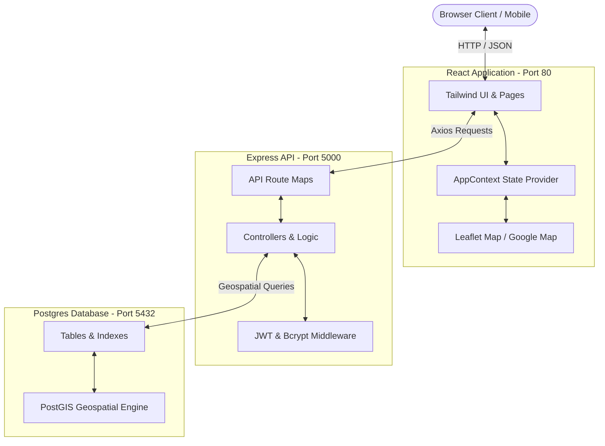
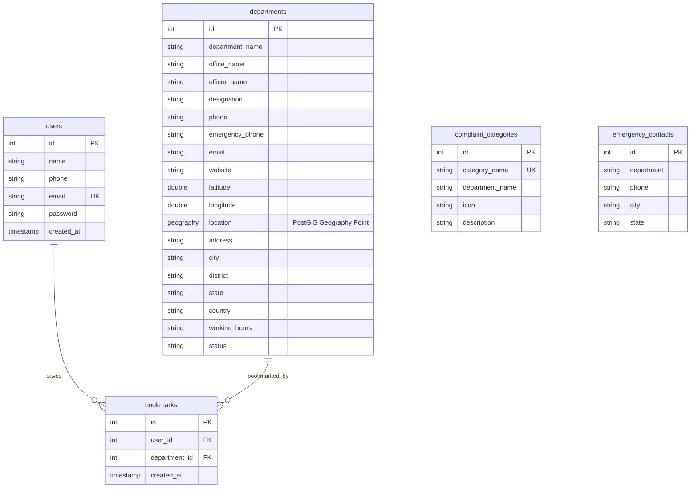
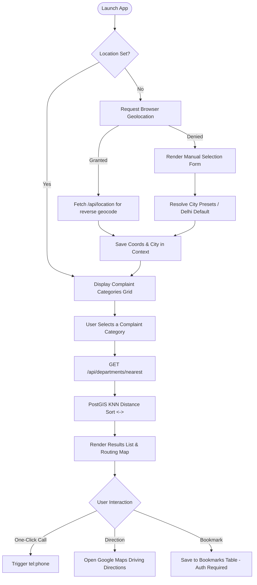

# System Architecture & Flows - CivicConnect

This document details the system design, ER diagrams, and logical flowcharts governing CivicConnect.

---

## 1. System Architecture

CivicConnect follows a standard, decoupled modern application architecture:

---

## 2. Database Schema (ER Diagram)

The relational schema maps citizen profiles, bookmarks, local emergency contacts, and departments. GIST indexes accelerate coordinates distance checks.

---

## 3. Application Flowchart

This flowchart maps the citizen's journey from location resolution through to spatial results and calling.

